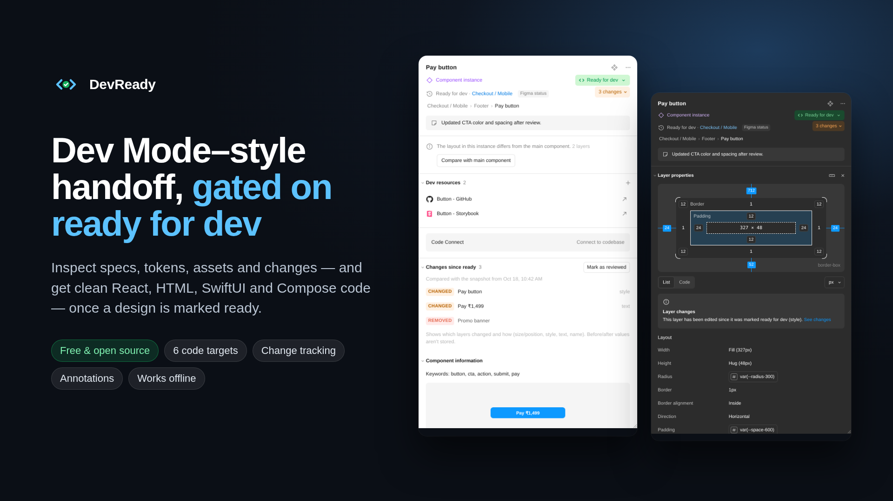
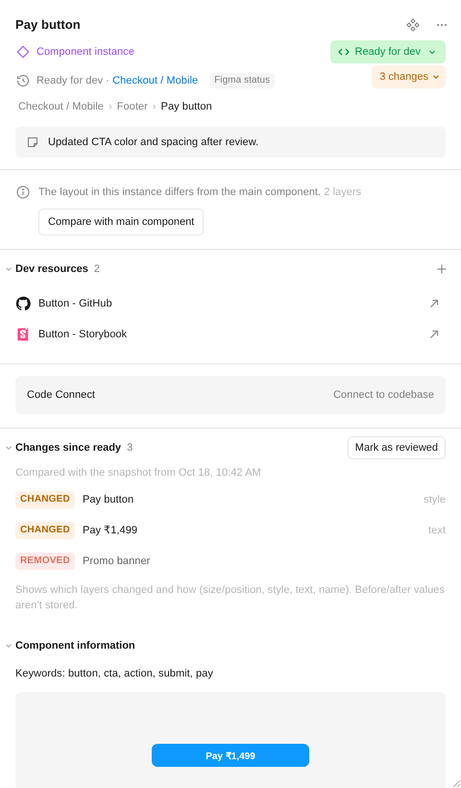
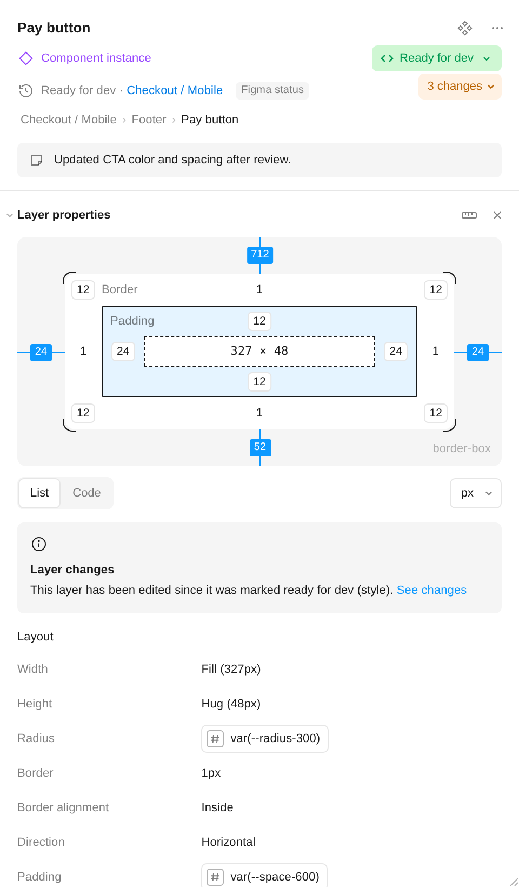
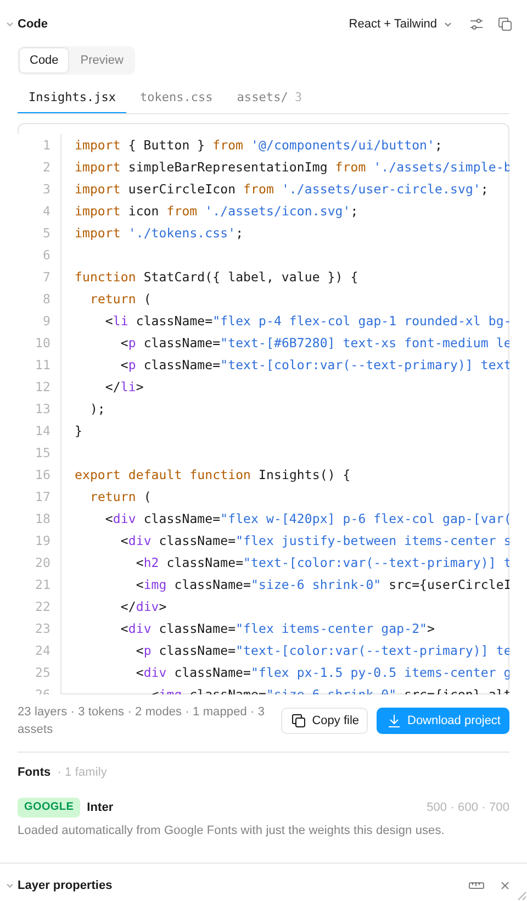
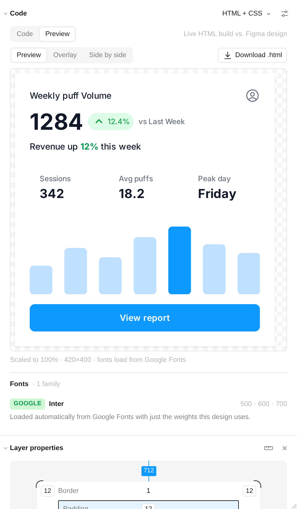
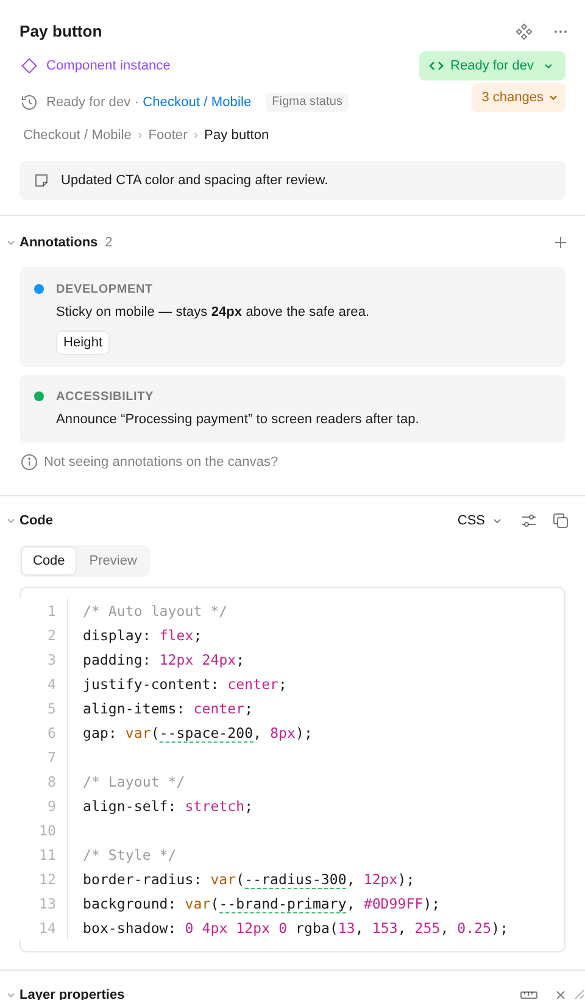
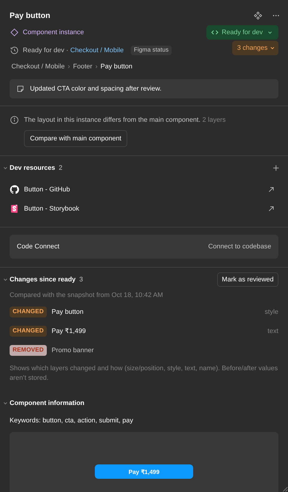

<p align="center"></p>

# DevReady

**A free, open-source Figma plugin for design handoff. Specs, tokens, assets, change tracking and production-quality code unlock when a design is marked *Ready for dev*.**

[](https://github.com/Ankushui18/Dev-Ready/actions/workflows/ci.yml)


> **Know what changed, what's missing and what developers need before a Figma design ships.**

- **Designers** mark a frame ready for dev (native Figma status, or a free DevReady flag when your plan doesn't support it).
- **Developers** select it and get a Dev Mode-style Inspect panel, plus code in 6 targets, a list of changes since handoff, and annotations.
- **Teams** that don't want a gate can turn it off with one click. Then it's simply a free inspector and code generator.

**Status:** v1.0.0 runs as a local development plugin. It's not on Figma Community yet ([launch checklist](docs/LAUNCH.md)).

---

## What it looks like

| Inspect | Layer properties | Code (React + Tailwind) |
|---|---|---|
|  |  |  |

| Preview vs. design | Annotations | Dark mode |
|---|---|---|
|  |  |  |

## Install (2 minutes)

1. Download this repo (**Code → Download ZIP**) and unzip it.
2. In the **Figma desktop app**, go to **Plugins → Development → Import plugin from manifest…** and pick `devready-plugin/manifest.json`.
3. Open any file and run **Plugins → Development → DevReady Inspect**.

In Dev Mode (Shift+D), you'll find it under **Inspect → Plugins → DevReady Inspect**, or as a language in **Inspect → Code**, named "DevReady · React + Tailwind" and so on.

> No Figma file to try it on? Open `devready-plugin/ui.html` in a browser. It runs the full panel on sample data.

## Features

| | |
|---|---|
| **Ready-for-dev gate** | Specs and code unlock for frames, components and sections marked *Ready for dev* or *Completed*. The panel always labels where a status comes from: **Figma status** (native) or **DevReady flag** (shared plugin data, for plans or modes where the native status can't be set). The gate is optional. |
| **Inspect** | Box model, layout, typography, colors, effects, variables with every mode (light/dark), interactions, component properties and overrides, dev resources, list or code view. |
| **Code** | React + Tailwind, React + CSS, HTML + CSS, single-file HTML, SwiftUI, Jetpack Compose. You get semantic tags, BEM classes, design tokens, reusable components for repeated instances, and a `fonts/` + `assets/` project ZIP. |
| **Preview & compare** | Renders the generated HTML next to, or overlaid on, the Figma design to spot differences. |
| **Change tracking** | Lists layers that changed since handoff (size/position, style, text, name), plus added and removed layers. |
| **Annotations** | Figma-native annotations with categories and pinned properties, and a canvas-note fallback that works on every plan. |
| **Assets & export** | Icons and images detected automatically. PNG/JPG/SVG/PDF at 0.5–4x, or everything as one ZIP. |

Full documentation: **[devready-plugin/README.md](devready-plugin/README.md)**

## Known limits (honest list)

- **Change tracking** shows before → after for position, size, fills, strokes, radius, effects, layout, font and text. Other edits, such as gradient stops or individual effect parameters, are flagged by category only. It covers the first 2,500 layers of a frame, and the panel warns when a frame is bigger.
- **Code** stops after a set number of layers: 600 in the panel, 1,500 for project downloads, and 150 in Dev Mode's Code section, which has a 3-second budget. The output says when this happens. Pick a smaller frame for the full tree.
- **Swift and Kotlin output** is checked for structure and safe string escaping, but isn't compiled in CI. JSX and CSS are parsed by esbuild.
- **Native annotations and Ready for dev** depend on your Figma plan and seat. See [Why annotations might not show](devready-plugin/README.md#why-annotations-might-not-show-on-the-canvas).
- Not yet tested on a matrix of real Figma files across Design Mode, Dev Mode, Inspect → Code and Figma for VS Code. The [launch checklist](docs/LAUNCH.md#environment-test-matrix) tracks this.

## Privacy

DevReady runs entirely inside Figma. **The plugin code makes no network requests.** Fonts are recognised using a bundled Google Fonts catalog. The only traffic is the live preview loading **public Google Fonts** (family and weights), so it renders in the design's typeface. Private or commercial font names are never sent, and you can switch it off with ⋯ → *Load Google Fonts in preview*. No layer names, text, images or file data leave Figma. Details, and everything the plugin stores in your file: **[PRIVACY.md](PRIVACY.md)**. Automated tests check these claims on every commit.

## Quality

```bash
npm ci
npm run verify        # layout + Figma sandbox check + ESLint + the test suite (what CI runs)
npm test              # 65 checks: 9 fixture designs × 6 code targets, privacy, message validation, change tracking
npm run lint          # ESLint 10, including the script inside ui.html
npm run test:browser  # Chromium: renders the panel and attacks the preview sandbox (needs Python Playwright)
```

Every commit is checked by [CI](.github/workflows/ci.yml):
- Generated code parses: JSX/CSS with esbuild; HTML, Swift and Kotlin with structural checks.
- Hostile layer names can't inject markup or break string literals.
- **The plugin code makes zero network requests**, and private font names never appear in a Google URL.
- **Every UI → plugin message** is validated against a schema (15 attack cases), and crafted component mappings stored in a file can't inject code.
- **The preview is sandboxed:** a hostile document can't run scripts, reach other hosts or touch the panel. This is checked in a real browser.
- Snapshots stay under Figma's 100 kB plugin-data limit, and before → after values are correct.
- The repository layout is correct, so a mis-placed upload fails CI.

Latest results: [docs/test-report.md](docs/test-report.md).

## Roadmap

1. Publish to Figma Community.
2. Run the environment matrix on real files, and fix what breaks.
3. Readiness checks: flag missing constraints, detached styles and hard-coded values before handoff.
4. Tailwind theme export (`tailwind.config` / v4 `@theme`) from Figma variables.
5. A benchmark suite of real-world designs with screenshot diffs of the generated code.

Ideas and bug reports are welcome. See [CONTRIBUTING.md](CONTRIBUTING.md).

## License

[MIT](LICENSE). Free for personal and commercial use.
